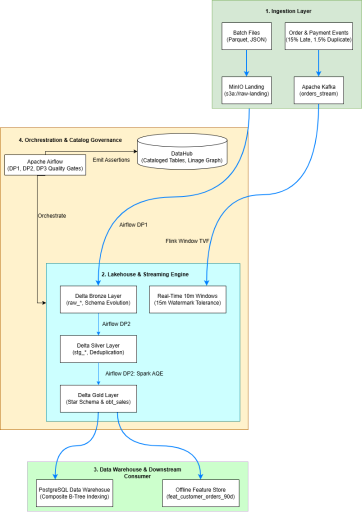

# Vietnam E-Commerce Food & Retail Platform
## Modern Data Platform Architecture (Layer 1)

[](docker-compose.yml)
[](https://spark.apache.org/)
[](https://flink.apache.org/)
[](https://delta.io/)
[](https://airflow.apache.org/)
[](https://datahubproject.io/)

---

## 1. Executive Summary

This repository contains the production-grade implementation of **Layer 1: Modern Data Platform** for a high-throughput **Vietnam E-Commerce Food & Retail Delivery System**. 

The platform is designed to handle both massive historical batch workloads and real-time streaming event delivery, implementing a unified **Medallion Lakehouse Architecture** (Delta Lake on MinIO), an enterprise **Kimball Star Schema Data Warehouse** (PostgreSQL), real-time stream aggregation (Apache Flink), scheduled workflow orchestration with fail-fast quality gates (Apache Airflow), and centralized data cataloging & governance (LinkedIn DataHub).



---

## 2. Repository Structure & Folder Tree

Below is the directory tree layout of the platform, organizing code, configuration, Docker infrastructure, and comprehensive technical documentation:

```text
.
├── dags/                                 # Apache Airflow DAG orchestration pipelines
│   ├── dp1_raw_to_bronze.py              # DP1: Raw landing to Bronze Delta Lake + quality gate
│   ├── dp2_bronze_to_gold.py             # DP2: Silver cleansing, Gold star schema & DWH sync
│   └── dp3_features.py                   # DP3: ML feature store extraction & DataHub lineage
├── data_generator/                       # Data generators simulating real-world anomalies
│   ├── offline/                          # Batch data generator (geographic skew, duplicates)
│   │   └── generate_data.py
│   └── streaming/                        # Streaming producer (late arrival & retry duplicates)
│       └── stream_producer.py
├── docker/                               # Infrastructure containerization & deployment
│   ├── Dockerfile                        # Multi-stage optimized application container
│   ├── Dockerfile.airflow                # Apache Airflow container definition
│   ├── Dockerfile.spark                  # Apache Spark Master & Worker cluster image
│   ├── Dockerfile.standard               # Single-stage standard baseline Dockerfile
│   ├── docker-compose.yml                # Core data platform services (MinIO, Spark, Postgres, Kafka)
│   ├── docker-compose.datahub.yml        # LinkedIn DataHub metadata catalog & GMS
│   └── requirements.txt                  # Python dependencies
├── docs/                                 # Project documentation & technical benchmarks
│   ├── images/                           # Screenshots and diagrams used across documentation
│   ├── airflow_pipelines.md              # Airflow DAGs, task components & fail-fast quality gates
│   ├── data_catalog_datahub.md           # DataHub dataset cataloging, lineage & quality assertions
│   ├── data_platform_layer_documentation.md # Medallion lakehouse architecture & star schema ERD
│   ├── docker_optimization_comparison.md # Multi-stage build comparison (64.9% size reduction)
│   ├── offline_data_characteristics.md   # Skew, high cardinality, schema evolution & duplicate analysis
│   ├── offline_data_optimization.md      # Spark join optimization (Baseline vs Salting vs AQE)
│   ├── storage_optimization.md           # Lakehouse Z-Ordering & PostgreSQL B-Tree indexing (406x speedup)
│   ├── streaming_data_characteristics.md # Stream anomalies: late arrivals (5-10m) & network retries
│   └── streaming_data_processing_flink.md# Flink Window TVF, watermark tolerance & deduplication
├── flink_jobs/                           # Apache Flink real-time streaming jobs
│   └── process_stream.py                 # Flink SQL 10m Tumbling Window & 15m watermark job
├── jars/                                 # Pre-packaged Java dependencies
│   └── flink-sql-connector-kafka-*.jar   # Kafka connector for PyFlink streaming
├── scripts/                              # Operational automation & metadata emission utilities
│   ├── emit_datahub_lineage.py           # REST emitter pushing lineage & assertions to DataHub
│   └── init_minio.py                     # S3 bucket provisioning & seed data loader
├── spark_jobs/                           # Apache Spark distributed batch jobs
│   ├── 00_test_connection.py            # MinIO S3A & PostgreSQL connectivity validation
│   ├── 01_process_skew.py                # Skew join benchmark (Naive, Salting, Spark 3.5 AQE)
│   ├── 02_raw_to_bronze.py               # Raw landing ingestion to Bronze with schema evolution
│   ├── 03_bronze_to_silver.py            # Silver cleansing & deterministic window deduplication
│   ├── 04_silver_to_gold.py              # Kimball star schema, SCD2 & OBT construction
│   ├── 05_optimize_to_storage.py         # Delta compaction, Z-Ordering & PostgreSQL indexing
│   └── 06_gold_to_feature.py             # RFM feature calculation for Feast feature store
├── sql/                                  # Database DDL & analytical queries
│   └── dwh_constraints.sql               # PostgreSQL DWH constraints & indexes
├── coursework_proposal.md                # Coursework scope & domain specification
├── pyproject.toml                        # Project metadata & Python packaging configuration
├── README.md                             # Root executive summary & platform documentation index
└── uv.lock                               # Deterministic dependency lockfile
```

---

## 3. Documentation Directory Index (`docs/`)

All detailed technical benchmarks, deep-dive architectural specifications, code explanations, and execution screenshots are organized into dedicated files inside the [**`docs/`**](docs/) directory.

### Quick Reference & Module Summary

| Section & Document | Core Topic | Key Results & Benchmarks |
| :--- | :--- | :--- |
| **[1. Docker Optimization Comparison](docs/docker_optimization_comparison.md)** | Multi-stage image build optimization | Reduced image size by **64.9%** (1.63 GB &rarr; 572 MB) by separating build dependencies from the runtime image. |
| **[2. Data Platform Medallion Layers](docs/data_platform_layer_documentation.md)** | 4-layer lakehouse architecture & dimensional schema | Complete Kimball Star Schema ERD (7 dimensions, 3 facts) and One Big Table (`obt_sales`) denormalization. |
| **[3. Offline Data Characteristics](docs/offline_data_characteristics.md)** | Real-world batch data anomalies | Identifies geographic skew (80% orders in Hanoi/HCMC), high-cardinality keys, 1.959% duplicate rate, and payment schema evolution. |
| **[4. Offline Spark Query Optimization](docs/offline_data_optimization.md)** | Distributed join skew optimization | Benchmarked Naive Baseline (2.587s) vs. Salting (3.903s) vs. **Spark 3.5 AQE (1.125s, 2.3x speedup)** with Spark UI screenshots. |
| **[5. Streaming Data Characteristics](docs/streaming_data_characteristics.md)** | Real-time event streaming anomalies | Real-world stream anomalies: 15% out-of-order events delayed 5–10 minutes and 1.5% duplicate network retry events. |
| **[6. Streaming Processing with Flink](docs/streaming_data_processing_flink.md)** | Apache Flink SQL Window TVF & watermarks | Tumbling 10-minute window with 15-minute watermark tolerance absorbing **100% of late events** (vs. 5s baseline dropping data) and First-Row deduplication. |
| **[7. Data Storage Optimization](docs/storage_optimization.md)** | Compaction, Z-Ordering & B-Tree Indexing | Lakehouse Delta Compaction + Z-Ordering on `obt_sales` and PostgreSQL Composite B-Tree Indexing on `fact_orders` yielding a **406x speedup** (69.17 ms down to 0.17 ms). |
| **[8. Apache Airflow Orchestration](docs/airflow_pipelines.md)** | End-to-end daily automated pipelines | 3 daily DAGs (`dp1_raw_to_bronze`, `dp2_bronze_to_gold`, `dp3_features`), fail-fast quality gates, and component-by-component breakdown. |
| **[9. Data Catalog & Governance](docs/data_catalog_datahub.md)** | LinkedIn DataHub metadata management | 42 cataloged tables across 3 platforms, multi-hop pipeline lineage, and 9 automated passing quality assertions. |

---

## 4. Platform Architecture Summaries

### 4.1 Medallion Lakehouse Layering
* **Landing Zone (`s3a://raw-landing/`)**: Immutable multi-format source data (JSON, Parquet, Hive partitioned).
* **Bronze Layer (`s3a://lakehouse-bronze/`)**: Delta Lake tables appending operational audit lineage (`_ingest_ts`, `_source_file`) with automated schema evolution (`mergeSchema = true`).
* **Silver Layer (`s3a://lakehouse-silver/`)**: Cleaned and validated staging tables. Deterministic Window deduplication on `(order_item_id)` eliminates all duplicate line items, while strings are trimmed and timestamps standardized to UTC.
* **Gold Layer (`s3a://lakehouse-gold/`)**: Dimensional Kimball Star Schema featuring `dim_customer` (SCD Type 2), 6 role dimensions with `-1` Unknown members, 3 facts (`fact_orders`, `fact_sales`, `fact_payments`), and One Big Table (`obt_sales`).
* *Detailed Document*: [**`docs/data_platform_layer_documentation.md`**](docs/data_platform_layer_documentation.md)

---

### 4.2 Offline Data Processing & Spark Optimization
When joining skewed order and customer datasets, naive Spark joins suffer from severe partition stragglers where a single task processes 80% of data.
* **Naive Baseline**: Suffers partition skew stragglers (2.587s).
* **Salting Approach**: Breaks skew key into 8 buckets, but adds CPU overhead of duplicate exploding and re-aggregating (3.903s).
* **Spark 3.5 Adaptive Query Execution (AQE)**: Automatically detects skewed partitions at runtime and dynamically splits them into balanced sub-partitions while coalescing empty shuffle partitions.
* **Result**: Query execution dropped from **2.587s down to 1.125s (2.3x faster)** with zero manual code salting.
* *Detailed Document*: [**`docs/offline_data_optimization.md`**](docs/offline_data_optimization.md)

---

### 4.3 Online Stream Processing with Apache Flink
The real-time streaming pipeline consumes from Kafka (`orders_stream`), addressing out-of-order event delivery and network duplicates:
* **Tumbling Window TVF**: Groups orders into 10-minute event-time aggregation windows (`TUMBLE(TABLE orders, DESCRIPTOR(order_time), INTERVAL '10' MINUTE)`).
* **Watermark Bounded Out-of-Orderness**: Configured with a 15-minute watermark delay (`order_time - INTERVAL '15' MINUTE`), absorbing 100% of delayed mobile network orders (which arrive 5–10 minutes late). Under a 5-second baseline watermark, 15% of late revenue is dropped permanently.
* **First-Row Deduplication**: Utilizes Flink SQL `ROW_NUMBER() OVER (PARTITION BY order_id ORDER BY order_time ASC) = 1` to filter duplicate retries in stateful stream memory.
* *Detailed Document*: [**`docs/streaming_data_processing_flink.md`**](docs/streaming_data_processing_flink.md)

---

### 4.4 Data Storage Optimization (Lakehouse & DWH)
Analytical workloads across big tables face physical I/O bottlenecks:
1. **Lakehouse Storage (Delta Lake)**: Distributed writes produce fragmented small Parquet files. Running `OPTIMIZE delta.obt_sales ZORDER BY (customer_id, product_id)` coalesces tiny files into uniform blocks and arranges records along a multi-dimensional space-filling curve, allowing Spark to skip ~80%+ of files during selective queries.
2. **Data Warehouse Storage (PostgreSQL)**: Point lookups filtering by customer and date suffer from full-table sequential scans (`Seq Scan`). Adding a composite B-Tree index `CREATE INDEX idx_fact_orders_cust_date ON fact_orders (customer_key, date_key)` converted sequential scans to index scans, reducing execution time from **69.17 ms to 0.17 ms (406x speedup)**.
* *Detailed Document*: [**`docs/storage_optimization.md`**](docs/storage_optimization.md)

---

### 4.5 Apache Airflow Workflow Orchestration
All data movement is scheduled and orchestrated through three decoupled DAGs running `@daily`:
* **`dp1_raw_to_bronze`**: Ingests raw files to Bronze Delta Lake and executes row-count parity quality gates.
* **`dp2_bronze_to_gold`**: Cleanses Bronze to Silver, builds Kimball Star Schema and `obt_sales` in Gold via Spark AQE, asserts referential integrity, and mirrors optimized storage to PostgreSQL DWH.
* **`dp3_features`**: Calculates offline 30d/90d customer behavioral features pinned to fixed `FEATURE_ANCHOR_TS = '2026-07-01'` (zero data leakage) and emits metadata to DataHub.
* **Fail-Fast Architecture**: Every transformation task is immediately followed by a validation quality gate. Any assertion failure immediately halts the pipeline, shielding downstream dashboards and ML systems.
* *Detailed Document*: [**`docs/airflow_pipelines.md`**](docs/airflow_pipelines.md)

---

### 4.6 Data Catalog, Lineage & Governance (DataHub)
Enterprise metadata is synchronized via `scripts/emit_datahub_lineage.py` communicating with DataHub GMS:
* **42 Cataloged Datasets**: Spans AWS S3, Delta Lake, and PostgreSQL.
* **Multi-Hop Lineage Graph**: Fully visualizes end-to-end provenance: `S3 Raw` &rarr; `Bronze` &rarr; `Silver` &rarr; `Gold` &rarr; `Features` / `PostgreSQL DWH`.
* **Data Quality Assertions**: Displays 9 passing assertions directly on dataset entity pages (e.g. `dp2.dim_customer.scd2_integrity` and `dp2.fact_orders.reconciliation`), giving data consumers immediate visibility into table reliability.
* *Detailed Document*: [**`docs/data_catalog_datahub.md`**](docs/data_catalog_datahub.md)

---

## 5. Local Environment & Service Ports

| Service Name | Container Name | Host Port | Internal Port | URL / Access |
| :--- | :--- | :---: | :---: | :--- |
| **Apache Airflow Webserver** | `food_delivery_airflow` | `8085` | `8080` | [http://localhost:8085](http://localhost:8085) (`admin:admin`) |
| **LinkedIn DataHub Frontend** | `food_delivery_console` | `8080` | `8080` | [http://localhost:8080](http://localhost:8080) (`datahub:datahub`) |
| **LinkedIn DataHub GMS** | `food_delivery_datahub_gms` | `8081` | `8080` | [http://localhost:8081](http://localhost:8081) |
| **Apache Spark Master** | `food_delivery_spark_master` | `9090` | `8080` | [http://localhost:9090](http://localhost:9090) |
| **MinIO Console (S3 Storage)**| `food_delivery_minio` | `9001` | `9001` | [http://localhost:9001](http://localhost:9001) (`admin:password123`) |
| **MinIO S3 API Endpoint** | `food_delivery_minio` | `9000` | `9000` | `http://localhost:9000` |
| **PostgreSQL Data Warehouse** | `food_delivery_postgres` | `5432` | `5432` | `localhost:5432` (db: `datawarehouse`) |
| **Apache Kafka Broker** | `food_delivery_kafka` | `9092` | `9092` | `localhost:9092` |

---

## 6. Quickstart Guide

### 6.1 Prerequisites
- Docker Engine & Docker Compose v2+
- Python 3.11+ (recommended managed via `uv`)

### 6.2 Starting the Platform Infrastructure
```bash
# 1. Start all infrastructure containers
docker compose up -d

# 2. Verify all services are healthy
docker ps --format "table {{.Names}}\t{{.Status}}\t{{.Ports}}"
```

### 6.3 Executing Batch Lakehouse Pipelines via Airflow
You can trigger pipelines directly from the Airflow Web UI at `http://localhost:8085` or via the CLI:
```bash
# Trigger DP1: Raw -> Bronze
docker exec food_delivery_airflow airflow dags trigger dp1_raw_to_bronze

# Trigger DP2: Bronze -> Silver -> Gold -> DWH
docker exec food_delivery_airflow airflow dags trigger dp2_bronze_to_gold

# Trigger DP3: Gold -> Feature Store -> DataHub
docker exec food_delivery_airflow airflow dags trigger dp3_features
```

### 6.4 Starting Real-Time Streaming with Apache Flink
```bash
# 1. Start order event stream producer (Kafka)
python stream_jobs/stream_producer.py --topic orders_stream --rate 10

# 2. Submit Flink streaming processing job
docker exec food_delivery_spark_master /opt/flink/bin/flink run \
    -py /opt/flink-apps/process_stream.py
```

### 6.5 Synchronizing Lineage & Quality Assertions to DataHub
```bash
# Push full catalog metadata, multi-hop lineage, and passing quality assertions
python scripts/emit_datahub_lineage.py --gms-url http://localhost:8081
```
