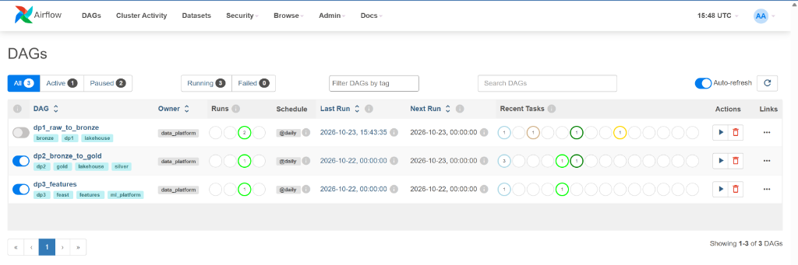
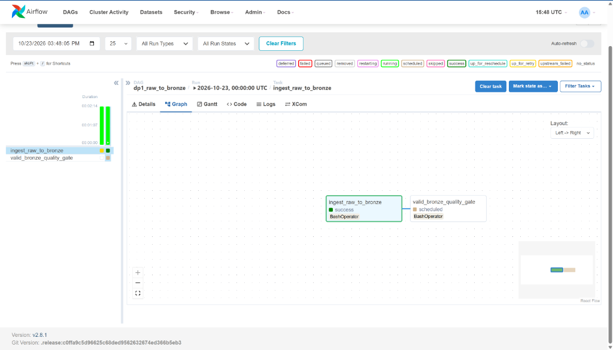
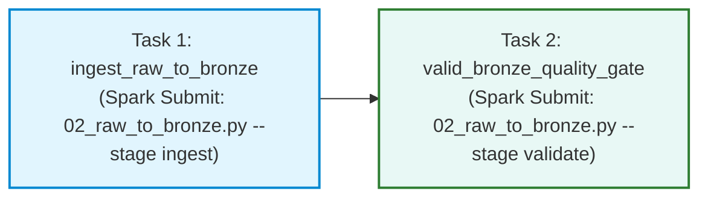
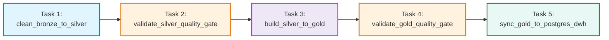
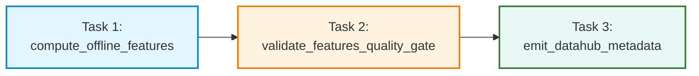

# Apache Airflow Pipeline Orchestration
**Vietnam E-Commerce Food & Retail Platform**

---

## 1. Executive Summary & Pipelines Overview

The modern Data Platform is orchestrated by **Apache Airflow**, organizing batch ETL and ML workflows into three decoupled, scheduled, and idempotent Directed Acyclic Graphs (DAGs):

1. **`dp1_raw_to_bronze`**: Ingests raw landing files into ACID Bronze Delta Lake tables with audit metadata and schema evolution.
2. **`dp2_bronze_to_gold`**: Cleanses Bronze data into Silver, builds the Kimball Star Schema and One Big Table (`obt_sales`) in Gold using Spark AQE, executes quality assertions, and optimizes downstream storage (Delta Z-Ordering & PostgreSQL B-Tree indexing).
3. **`dp3_features`**: Computes temporal-safe offline behavioral customer features for ML/Feast and emits cross-layer data lineage and quality assertions to DataHub.

### Airflow UI Dashboard (All 3 Pipelines Active & Succeeded)



### Summary Matrix of Pipelines

| Pipeline DAG ID | Target Layer | Schedule | Operator Pattern | Number of Tasks | Key Quality Gate |
| :--- | :--- | :---: | :--- | :---: | :--- |
| **`dp1_raw_to_bronze`** | Landing &rarr; Bronze | `@daily` | `BashOperator` (Spark Submit) | 2 | Parquet landing vs. Bronze row count parity & schema preservation. |
| **`dp2_bronze_to_gold`** | Bronze &rarr; Silver &rarr; Gold &rarr; DWH | `@daily` | `BashOperator` (Spark Submit) | 5 | Zero duplicate PKs, 0 orphan FKs, SCD2 time validity, line-item reconciliation. |
| **`dp3_features`** | Gold &rarr; Feature Store &rarr; Catalog | `@daily` | `BashOperator` (Spark & DataHub SDK) | 3 | Zero data leakage (anchor timestamp), non-null features, catalog lineage emission. |

---

## 2. Pipeline 1: `dp1_raw_to_bronze` (Raw Ingestion to Bronze Lakehouse)

### 2.1 Pipeline Objective
The purpose of `dp1_raw_to_bronze` is to ingest raw heterogeneous source files (Parquet and partitioned datasets) from the MinIO raw landing bucket (`s3a://raw-landing/`) into ACID Delta Lake Bronze tables (`s3a://lakehouse-bronze/`). 

It guarantees:
- **Immutable Raw Ingestion**: Captures incoming data in its raw fidelity without destructive transformations.
- **Audit Lineage**: Appends operational lineage metadata (`_ingest_ts` UTC timestamp and `_source_file` origin path) to every ingested record.
- **Schema Evolution**: Automatically absorbs additive schema changes (such as new columns in payment batches) using Delta Lake `mergeSchema = true`.
- **Partition Preservation**: Preserves Hive partition columns (e.g., `payment_date`, `order_date`) without column drops.

### 2.2 Pipeline Topology & Execution Graph





### 2.3 Component Breakdown

| Task ID | Operator / Engine | Underlying Script & Command | What It Does |
| :--- | :--- | :--- | :--- |
| **`ingest_raw_to_bronze`** | `BashOperator` &rarr; Spark Submit | `spark-submit /opt/spark-apps/02_raw_to_bronze.py --stage ingest` | Reads 5 raw landing datasets: `customers`, `products`, `orders`, `order_items`, and `payments`. Appends `_ingest_ts` and `_source_file`. Ingests payments in 2 batches to demonstrate automated schema evolution (`mergeSchema=true` adding `failure_reason`). Writes data into partitioned Bronze Delta tables. |
| **`valid_bronze_quality_gate`** | `BashOperator` &rarr; Spark Submit | `spark-submit /opt/spark-apps/02_raw_to_bronze.py --stage validate` | Quality gate assertion checking: 1) Every Bronze table is non-empty; 2) Row counts exactly match raw landing source files; 3) All audit columns are populated. Exits with code `0` on pass or code `1` on failure, halting downstream pipelines immediately if data is lost. |

---

## 3. Pipeline 2: `dp2_bronze_to_gold` (Cleansing, Dimensional Modeling & DWH Optimization)

### 3.1 Pipeline Objective
`dp2_bronze_to_gold` is the core transformation and analytical backbone of the lakehouse. It processes Bronze tables into cleaned Silver tables, models dimensional Kimball entities and wide denormalized tables in Gold, enforces strict referential integrity quality gates, and mirrors data to the PostgreSQL Data Warehouse with query storage optimizations.

It guarantees:
- **Silver Cleansing & Deduplication**: Removes whitespace, casts string dates to UTC timestamps, and eliminates duplicate order items via deterministic Window ranking.
- **Kimball Dimensional Modeling**: Builds 7 dimension tables (including `dim_customer` SCD Type 2 with surrogate keys and active date intervals) and 3 fact tables, with `-1` Unknown Member rows for unmatched records.
- **Adaptive Query Execution (AQE)**: Speeds up heavy analytical joins using Spark 3.5 AQE skew join handling and coalescing.
- **Fail-Fast Quality Gates**: Halts execution if orphan foreign keys, overlapping SCD2 intervals, or line-item price mismatches are detected.
- **Storage Optimization**: Automatically runs Delta Lake Compaction and Z-Ordering on `obt_sales`, and creates composite B-Tree indexes in PostgreSQL DWH.

### 3.2 Pipeline Topology & Execution Graph



### 3.3 Component Breakdown

| Task ID | Operator / Engine | Underlying Script & Command | What It Does |
| :--- | :--- | :--- | :--- |
| **`clean_bronze_to_silver`** | `BashOperator` &rarr; Spark Submit | `spark-submit /opt/spark-apps/03_bronze_to_silver.py --stage ingest` | Trims text fields, converts all timestamps to UTC, filters corrupt records with null IDs, and removes duplicate order items using `row_number().over(Window.partitionBy("order_item_id").orderBy(desc("_ingest_ts")))`. Writes cleaned tables to `s3a://lakehouse-silver/`. |
| **`validate_silver_quality_gate`** | `BashOperator` &rarr; Spark Submit | `spark-submit /opt/spark-apps/03_bronze_to_silver.py --stage validate` | Validates that all 5 Silver tables have 100% primary key uniqueness (zero duplicates), non-null mandatory fields, and non-negative amounts/quantities. Exits with code `1` if duplicate keys or anomalies remain. |
| **`build_silver_to_gold`** | `BashOperator` &rarr; Spark Submit | `spark-submit /opt/spark-apps/04_silver_to_gold.py --stage ingest` | Generates the Kimball Star Schema: 7 dimensions (`dim_date`, `dim_customer` SCD2, `dim_product`, `dim_order_status`, `dim_payment_method`, `dim_payment_status`, `dim_shipping_location`), 3 facts (`fact_orders`, `fact_sales`, `fact_payments`), and One Big Table (`obt_sales`) using Spark AQE. Seeds `-1` Unknown members in every dimension. |
| **`validate_gold_quality_gate`** | `BashOperator` &rarr; Spark Submit | `spark-submit /opt/spark-apps/04_silver_to_gold.py --stage validate` | Executes analytical assertions: 1) 0 orphan foreign keys in fact tables; 2) 0 overlapping effective date ranges in `dim_customer` SCD2; 3) Exact financial reconciliation: `sum(line_total) == order_subtotal`. Blocks downstream DWH sync if any check fails. |
| **`sync_gold_to_postgres_dwh`** | `BashOperator` &rarr; Spark Submit | `spark-submit /opt/spark-apps/05_optimize_to_storage.py` | Mirrors all Gold tables to PostgreSQL Data Warehouse via JDBC. Runs Delta Lake `OPTIMIZE obt_sales ZORDER BY (customer_id, product_id)` to compact small files and enable multi-dimensional data skipping. Creates composite B-Tree index `idx_fact_orders_cust_date` in PostgreSQL. |

---

## 4. Pipeline 3: `dp3_features` (Offline ML Feature Store & Catalog Lineage)

### 4.1 Pipeline Objective
`dp3_features` bridges analytical data warehousing with production Machine Learning. It computes customer order propensity features for ML model training and Feast feature stores, validates feature distribution health, and automatically publishes end-to-end data lineage and test assertions to DataHub.

It guarantees:
- **Zero Temporal Data Leakage**: Features are calculated relative to an immutable anchor timestamp (`FEATURE_ANCHOR_TS = '2026-07-01 00:00:00' UTC`), preventing future data from contaminating training sets.
- **Multi-Window Aggregations**: Computes 30-day and 90-day RFM features (frequency, monetary value, average order value, recency days, and top category).
- **Automated Catalog Registration**: Synchronizes complete lineage graphs (Raw &rarr; Bronze &rarr; Silver &rarr; Gold &rarr; Features) and quality assertions into DataHub catalog.

### 4.2 Pipeline Topology & Execution Graph



### 4.3 Component Breakdown

| Task ID | Operator / Engine | Underlying Script & Command | What It Does |
| :--- | :--- | :--- | :--- |
| **`compute_offline_features`** | `BashOperator` &rarr; Spark Submit | `spark-submit /opt/spark-apps/06_gold_to_feature.py --stage ingest` | Joins `fact_orders`, `fact_sales`, and dimensions. Aggregates customer behavioral features over 30d and 90d sliding windows prior to `FEATURE_ANCHOR_TS`. Computes order counts, total GMV spend, AOV, favorite category, and days since last purchase. Writes to Delta Lake and PostgreSQL DWH (`feat_customer_orders_90d`). |
| **`validate_features_quality_gate`** | `BashOperator` &rarr; Spark Submit | `spark-submit /opt/spark-apps/06_gold_to_feature.py --stage validate` | Validates feature store health: 1) 100% customer primary key uniqueness; 2) Zero null values in anchor timestamp and metrics; 3) Numerical bounds sanity check (all order counts and spends &ge; 0). |
| **`emit_datahub_metadata`** | `BashOperator` &rarr; Python SDK | `python /opt/airflow/scripts/emit_datahub_lineage.py --gms-url http://datahub-gms:8080` | Runs only when feature validation passes. Publishes dataset definitions, column schemas, cross-pipeline multi-hop upstream/downstream lineage, and verification assertion status (PASSED) to the DataHub GMS REST endpoint. |

---

## 5. Architectural Quality Gate & Operational Design

### 5.1 "Fail-Fast" Quality Gate Pattern
Every pipeline follows a strict **Compute &rarr; Validate** pattern. Transformation tasks never directly expose untrusted data to downstream layers without passing through a dedicated validation task:

```
[ Ingest / Transform Task ] ──(Success)──> [ Quality Gate Task ] ──(Pass: Code 0)──> [ Downstream Dependent Task ]
                                                   │
                                                   └──(Fail: Code 1)──> [ Pipeline HALTS ]
```

- If an assertion fails (e.g. duplicate key or missing foreign key), the script terminates with `sys.exit(1)`.
- Airflow immediately marks the validation task as `FAILED`, stopping the DAG run and protecting downstream BI dashboards, PostgreSQL DWH, and ML models from corrupted data.

### 5.2 Idempotency & Fault Tolerance
All 3 pipelines are fully **idempotent**:
- Ingestion and transformation jobs use Delta Lake ACID transactions with `overwriteSchema = true` and deterministic partition overwrites.
- Re-running any pipeline due to transient network failure or upstream delay safely recalculates data without producing duplicate rows or orphaned files.
- Decoupled worker architecture: Airflow acts as a pure scheduler and orchestrator using `BashOperator` to dispatch commands into `food_delivery_spark_master`, ensuring the Airflow webserver and scheduler remain lightweight and responsive.
