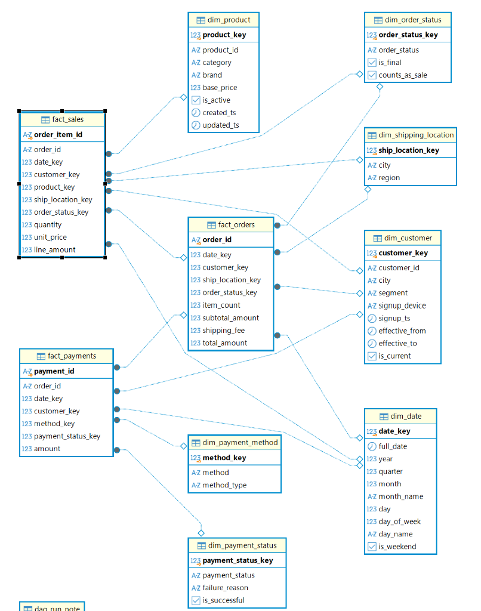

# Data Platform Layer Documentation

---

## 1. Raw Landing Layer (`MinIO: s3a://raw-landing/`)

The Raw Landing layer stores untouched files directly produced by the offline generators and streaming Kafka dumpers. Data here is raw, immutable, and retains all simulated data anomalies (skew, duplicates, schema evolution).

### 1.1 `orders`
- **Purpose**: Captures raw order placement records from the e-commerce checkout service.
- **Skew Note**: Heavily skewed. ~80% of all orders originate from Ho Chi Minh City (`shipping_city = 'TP. Hồ Chí Minh'`), ~15% from Hanoi, and ~5% from Da Nang.

| Column | Data Type | Meaning / Description |
| :--- | :--- | :--- |
| `order_id` | STRING | Unique identifier of the placed order. |
| `customer_id` | STRING | Identifier of the customer who placed the order. |
| `order_ts` | STRING | ISO-8601 timestamp string of when checkout occurred. |
| `status` | STRING | Order lifecycle status (`PENDING`, `CONFIRMED`, `DELIVERED`, `CANCELLED`). |
| `shipping_city` | STRING | Destination delivery city (causes 80% partition skew). |
| `shipping_fee` | BIGINT | Flat shipping fee in integer VND. |
| `total_amount` | BIGINT | Total payable amount in integer VND. |

---

### 1.2 `order_items`
- **Purpose**: Stores individual product line items belonging to an order.
- **Data Issue Note**: Contains ~2% duplicate records simulating an e-commerce network retry bug.

| Column | Data Type | Meaning / Description |
| :--- | :--- | :--- |
| `order_item_id` | STRING | Unique line item identifier (has ~2% duplicates). |
| `order_id` | STRING | Foreign key referencing the parent order. |
| `product_id` | STRING | Foreign key referencing the purchased product. |
| `quantity` | INTEGER | Number of units purchased. |
| `unit_price` | BIGINT | Unit price per item at time of purchase in integer VND. |

---

### 1.3 `customers`
- **Purpose**: Raw snapshot of registered user profiles.

| Column | Data Type | Meaning / Description |
| :--- | :--- | :--- |
| `customer_id` | STRING | Unique identifier of the customer. |
| `city` | STRING | Customer residence city. |
| `segment` | STRING | Marketing tier (`REGULAR`, `VIP`, `NEW`). |
| `device_type` | STRING | Primary device used (`iOS`, `Android`, `Web`). |
| `signup_ts` | STRING | Timestamp string of account registration. |
| `updated_ts` | STRING | Timestamp string of profile update (for SCD2 tracking). |

---

### 1.4 `products`
- **Purpose**: Raw product catalog information.
- **Skew Note**: Category skew. ~75% of items belong to the Food & Beverage and Electronics categories.

| Column | Data Type | Meaning / Description |
| :--- | :--- | :--- |
| `product_id` | STRING | Unique identifier of the product. |
| `category` | STRING | Product category name. |
| `brand` | STRING | Brand or vendor name. |
| `base_price` | BIGINT | Catalog list price in integer VND. |
| `is_active` | BOOLEAN | Whether the product is actively listed for sale. |
| `created_ts` | STRING | Timestamp string when product was added. |

---

### 1.5 `payments`
- **Purpose**: Raw logs of payment transaction attempts.
- **Schema Evolution Note**: Earlier batches only have 6 columns; newer batches introduce a 7th column (`failure_reason`) when gateway failures occur.

| Column | Data Type | Meaning / Description |
| :--- | :--- | :--- |
| `payment_id` | STRING | Unique identifier of the payment attempt. |
| `order_id` | STRING | Foreign key referencing the order. |
| `payment_ts` | STRING | Timestamp string of transaction attempt. |
| `method` | STRING | Payment channel (`MOMO`, `ZALOPAY`, `VNPAY`, `COD`, `CREDIT_CARD`). |
| `amount` | BIGINT | Transacted amount in integer VND. |
| `status` | STRING | Payment outcome (`SUCCESS`, `FAILED`). |
| `failure_reason` | STRING | Evolved column: Cause of failure (e.g. `INSUFFICIENT_FUNDS`, `TIMEOUT`). NULL in older records. |

---

## 2. Bronze Lakehouse Layer (`s3a://lakehouse-bronze/`)

The Bronze layer converts raw files into Delta Lake tables. It performs 1:1 ingestion with schema merging (`mergeSchema = true`) and appends audit metadata without altering raw values.

### Common Audit Columns in all Bronze Tables
Every table in Bronze has two audit tracking columns appended:
- `_ingest_ts` (TIMESTAMP): The exact UTC timestamp when the record was ingested into the lakehouse.
- `_source_file` (STRING): The source file URI in MinIO/S3 from which the record was loaded.

---

### 2.1 `raw_orders`
- **Purpose**: Delta Lake storage of raw orders.
- **Skew Note**: Inherits the 80% Ho Chi Minh City order concentration.

| Column | Data Type | Meaning / Description |
| :--- | :--- | :--- |
| `order_id` | StringType | Order identifier. |
| `customer_id` | StringType | Customer identifier. |
| `order_ts` | TimestampType | Order checkout timestamp. |
| `status` | StringType | Order status string. |
| `shipping_city` | StringType | Delivery city. |
| `shipping_fee` | LongType | Flat shipping fee (VND). |
| `total_amount` | LongType | Total order amount (VND). |
| `_ingest_ts` | TimestampType | Ingestion audit timestamp. |
| `_source_file` | StringType | Provenance source path. |

---

### 2.2 `raw_order_items`
- **Purpose**: Delta Lake storage of raw order items, retaining the 2% duplicate lines.

| Column | Data Type | Meaning / Description |
| :--- | :--- | :--- |
| `order_item_id` | StringType | Line item identifier. |
| `order_id` | StringType | Order foreign key. |
| `product_id` | StringType | Product foreign key. |
| `quantity` | IntegerType | Units purchased. |
| `unit_price` | LongType | Price per item (VND). |
| `_ingest_ts` | TimestampType | Ingestion audit timestamp. |
| `_source_file` | StringType | Provenance source path. |

---

### 2.3 `raw_customers`
- **Purpose**: Delta Lake storage of customer registration snapshots.

| Column | Data Type | Meaning / Description |
| :--- | :--- | :--- |
| `customer_id` | StringType | Customer identifier. |
| `city` | StringType | City name. |
| `segment` | StringType | Customer tier. |
| `device_type` | StringType | Device platform. |
| `signup_ts` | TimestampType | Signup timestamp. |
| `updated_ts` | TimestampType | Profile update timestamp. |
| `_ingest_ts` | TimestampType | Ingestion audit timestamp. |
| `_source_file` | StringType | Provenance source path. |

---

### 2.4 `raw_products`
- **Purpose**: Delta Lake storage of catalog products.

| Column | Data Type | Meaning / Description |
| :--- | :--- | :--- |
| `product_id` | StringType | Product identifier. |
| `category` | StringType | Category name. |
| `brand` | StringType | Brand name. |
| `base_price` | LongType | List price (VND). |
| `is_active` | BooleanType | Active status. |
| `created_ts` | TimestampType | Creation timestamp. |
| `_ingest_ts` | TimestampType | Ingestion audit timestamp. |
| `_source_file` | StringType | Provenance source path. |

---

### 2.5 `raw_payments`
- **Purpose**: Delta Lake storage of payment transactions with merged schema.

| Column | Data Type | Meaning / Description |
| :--- | :--- | :--- |
| `payment_id` | StringType | Payment transaction identifier. |
| `order_id` | StringType | Order foreign key. |
| `payment_ts` | TimestampType | Payment timestamp. |
| `method` | StringType | Payment method. |
| `amount` | LongType | Amount transacted (VND). |
| `status` | StringType | Transaction status. |
| `failure_reason` | StringType | Evolved failure cause (populated or NULL). |
| `_ingest_ts` | TimestampType | Ingestion audit timestamp. |
| `_source_file` | StringType | Provenance source path. |

---

## 3. Silver Layer (`s3a://lakehouse-silver/`)

The Silver layer cleans, deduplicates, and standardizes data. Corrupt records are filtered out, duplicate line items are purged, dates are standardized, and data is made query-ready for dimensional modeling.

### 3.1 `stg_orders`
- **Purpose**: Deduplicated and validated orders. Dates are extracted to allow clean daily partitioning.
- **Skew Note**: Still reflects real-world city distribution (80% HCMC), but ready for Spark AQE skew-join handling in Gold.

| Column | Data Type | Meaning / Description |
| :--- | :--- | :--- |
| `order_id` | StringType | Primary Key: unique order ID. |
| `customer_id` | StringType | Foreign key referencing customers. |
| `order_ts` | TimestampType | Order timestamp in UTC. |
| `order_date` | DateType | Date part of `order_ts` (`yyyy-MM-dd`). |
| `status` | StringType | Standardized status. |
| `shipping_city` | StringType | Standardized destination city. |
| `shipping_fee` | LongType | Verified non-negative shipping fee (VND). |
| `total_amount` | LongType | Verified positive order total (VND). |

---

### 3.2 `stg_order_items`
- **Purpose**: Cleaned line items. The 2% duplicate records are eliminated via `dropDuplicates(['order_item_id'])`.

| Column | Data Type | Meaning / Description |
| :--- | :--- | :--- |
| `order_item_id` | StringType | Primary Key: unique line item ID. |
| `order_id` | StringType | Foreign key referencing `stg_orders`. |
| `product_id` | StringType | Foreign key referencing `stg_products`. |
| `quantity` | IntegerType | Item count ($\ge 1$). |
| `unit_price` | LongType | Unit price in VND ($\ge 0$). |
| `line_amount` | LongType | Calculated line total: `quantity * unit_price` (VND). |

---

### 3.3 `stg_customers`
- **Purpose**: Standardized customer profiles. Field names are normalized (`device_type` $\rightarrow$ `signup_device`).

| Column | Data Type | Meaning / Description |
| :--- | :--- | :--- |
| `customer_id` | StringType | Natural business key of customer. |
| `city` | StringType | Trimmed and standardized city name. |
| `segment` | StringType | Uppercase customer tier. |
| `signup_device` | StringType | Device platform used at registration. |
| `signup_ts` | TimestampType | Signup timestamp in UTC. |
| `updated_ts` | TimestampType | Modification timestamp in UTC. |

---

### 3.4 `stg_products`
- **Purpose**: Validated product catalog with clean categories and boolean active flags.

| Column | Data Type | Meaning / Description |
| :--- | :--- | :--- |
| `product_id` | StringType | Primary Key: unique product ID. |
| `category` | StringType | Standardized category. |
| `brand` | StringType | Standardized brand. |
| `base_price` | LongType | Catalog price in VND. |
| `is_active` | BooleanType | Active listing flag (`true`/`false`). |
| `created_ts` | TimestampType | Creation timestamp in UTC. |

---

### 3.5 `stg_payments`
- **Purpose**: Cleaned payment transactions. Preserves `failure_reason` and normalizes payment methods.

| Column | Data Type | Meaning / Description |
| :--- | :--- | :--- |
| `payment_id` | StringType | Primary Key: unique payment ID. |
| `order_id` | StringType | Foreign key referencing `stg_orders`. |
| `payment_ts` | TimestampType | Payment timestamp in UTC. |
| `payment_date` | DateType | Date part of `payment_ts`. |
| `method` | StringType | Standardized payment method code. |
| `amount` | LongType | Transacted amount in VND. |
| `status` | StringType | Transaction outcome. |
| `failure_reason` | StringType | Failure description (or `'NONE'`). |

---

## 4. Gold Layer (`s3a://lakehouse-gold/` & PostgreSQL DWH)

The Gold layer models business data into a Kimball Star Schema (Facts & Dimensions), a One Big Table (OBT) reporting mart, and an Offline Feature Store table.

### 4.0 Kimball Star Schema Architecture & Entity-Relationship Diagram (ERD)

---

### 4.1 Dimension: `dim_customer` (SCD Type 2)
- **Purpose**: Tracks customer profile changes (e.g. moving cities) over time without overwriting history.

| Column | Data Type | Meaning / Description |
| :--- | :--- | :--- |
| `customer_key` | LongType | Surrogate Primary Key: `xxhash64(customer_id, effective_from)`. |
| `customer_id` | StringType | Natural business key. |
| `city` | StringType | Customer city at this version. |
| `segment` | StringType | Customer tier at this version. |
| `signup_device` | StringType | Device at registration. |
| `signup_ts` | TimestampType | Registration timestamp. |
| `effective_from` | TimestampType | Start timestamp of this version validity window. |
| `effective_to` | TimestampType | End timestamp of this version (`9999-12-31` if current). |
| `is_current` | BooleanType | `true` if this is the active customer profile. |

---

### 4.2 Dimension: `dim_product`
- **Purpose**: Conformed dimension for products.

| Column | Data Type | Meaning / Description |
| :--- | :--- | :--- |
| `product_key` | LongType | Surrogate Primary Key: `xxhash64(product_id)`. |
| `product_id` | StringType | Natural product ID. |
| `category` | StringType | Category name. |
| `brand` | StringType | Brand name. |
| `base_price` | LongType | Catalog price in VND. |
| `is_active` | BooleanType | Active flag. |
| `created_ts` | TimestampType | Creation timestamp. |
| `updated_ts` | TimestampType | Last update timestamp. |

---

### 4.3 Dimension: `dim_date`
- **Purpose**: Date dimension for calendar navigation and time-series aggregation.

| Column | Data Type | Meaning / Description |
| :--- | :--- | :--- |
| `date_key` | IntegerType | Surrogate Primary Key: format `YYYYMMDD` (e.g. `20260515`). |
| `full_date` | DateType | Actual calendar date. |
| `year` | IntegerType | Year integer (e.g. `2026`). |
| `quarter` | IntegerType | Quarter of the year (1 to 4). |
| `month` | IntegerType | Month number (1 to 12). |
| `month_name` | StringType | Full month name (e.g. `May`). |
| `day` | IntegerType | Day of the month (1 to 31). |
| `day_of_week` | IntegerType | Day index (1 = Sunday, 7 = Saturday). |
| `day_name` | StringType | Day name (e.g. `Friday`). |
| `is_weekend` | BooleanType | `true` if Saturday or Sunday. |

---

### 4.4 Dimension: `dim_order_status`
- **Purpose**: Small lookup dimension mapping order statuses, finality, and revenue qualification.

| Column | Data Type | Meaning / Description |
| :--- | :--- | :--- |
| `order_status_key` | IntegerType | Surrogate Primary Key. |
| `order_status` | StringType | Status text (`DELIVERED`, `CANCELLED`, etc.). |
| `is_final` | BooleanType | `true` if status has reached terminal state. |
| `counts_as_sale` | BooleanType | `true` if the status represents earned revenue. |

---

### 4.5 Dimension: `dim_shipping_location`
- **Purpose**: Geographic destination lookup dimension.

| Column | Data Type | Meaning / Description |
| :--- | :--- | :--- |
| `ship_location_key` | IntegerType | Surrogate Primary Key. |
| `city` | StringType | Destination city. |
| `region` | StringType | Geographic zone (`South`, `North`, `Central`). |

---

### 4.6 Dimension: `dim_payment_method`
- **Purpose**: Lookup dimension for payment mechanisms.

| Column | Data Type | Meaning / Description |
| :--- | :--- | :--- |
| `method_key` | IntegerType | Surrogate Primary Key. |
| `method` | StringType | Method code (`MOMO`, `COD`, `CREDIT_CARD`). |
| `method_type` | StringType | Category (`E_WALLET`, `CASH`, `CARD`). |

---

### 4.7 Dimension: `dim_payment_status`
- **Purpose**: Lookup dimension for payment transaction outcomes.

| Column | Data Type | Meaning / Description |
| :--- | :--- | :--- |
| `payment_status_key` | IntegerType | Surrogate Primary Key. |
| `payment_status` | StringType | Status (`SUCCESS`, `FAILED`). |
| `failure_reason` | StringType | Specific failure reason or `'NONE'`. |
| `is_successful` | BooleanType | `true` if payment succeeded. |

---

### 4.8 Fact: `fact_orders`
- **Purpose**: Order-level transactions.
- **Grain**: Exactly one row per order.

| Column | Data Type | Meaning / Description |
| :--- | :--- | :--- |
| `order_id` | StringType | Natural Order ID (Primary Key). |
| `date_key` | IntegerType | Foreign key referencing `dim_date`. |
| `customer_key` | LongType | Foreign key referencing `dim_customer` (point-in-time SCD2). |
| `ship_location_key` | IntegerType | Foreign key referencing `dim_shipping_location`. |
| `order_status_key` | IntegerType | Foreign key referencing `dim_order_status`. |
| `order_ts` | TimestampType | Order timestamp in UTC. |
| `item_count` | IntegerType | Total number of item lines in this order. |
| `subtotal_amount` | LongType | Merchandise subtotal before shipping fees (VND). |
| `shipping_fee` | LongType | Flat shipping fee (VND). |
| `total_amount` | LongType | Total payable order revenue (VND). |

---

### 4.9 Fact: `fact_sales`
- **Purpose**: Line-item sales transactions.
- **Grain**: Exactly one row per item line inside an order.

| Column | Data Type | Meaning / Description |
| :--- | :--- | :--- |
| `order_item_id` | StringType | Natural line item ID (Primary Key). |
| `order_id` | StringType | Parent order reference ID. |
| `date_key` | IntegerType | Foreign key referencing `dim_date`. |
| `customer_key` | LongType | Foreign key referencing `dim_customer` (point-in-time SCD2). |
| `product_key` | LongType | Foreign key referencing `dim_product`. |
| `ship_location_key` | IntegerType | Foreign key referencing `dim_shipping_location`. |
| `order_status_key` | IntegerType | Foreign key referencing `dim_order_status`. |
| `quantity` | IntegerType | Item quantity sold. |
| `unit_price` | LongType | Unit price at sale in VND. |
| `line_amount` | LongType | Line total (`quantity * unit_price`) in VND. |

---

### 4.10 Fact: `fact_payments`
- **Purpose**: Financial settlement transactions.
- **Grain**: Exactly one row per payment attempt.

| Column | Data Type | Meaning / Description |
| :--- | :--- | :--- |
| `payment_id` | StringType | Payment transaction reference (Primary Key). |
| `order_id` | StringType | Order reference. |
| `date_key` | IntegerType | Foreign key referencing `dim_date`. |
| `customer_key` | LongType | Foreign key referencing `dim_customer`. |
| `method_key` | IntegerType | Foreign key referencing `dim_payment_method`. |
| `payment_status_key` | IntegerType | Foreign key referencing `dim_payment_status`. |
| `payment_ts` | TimestampType | Payment timestamp in UTC. |
| `amount` | LongType | Amount transacted in VND. |

---

### 4.11 Mart: `obt_sales` (One Big Table)
- **Purpose**: Denormalized flat reporting table pre-joining `fact_sales` with all surrounding dimensions (`dim_date`, `dim_customer`, `dim_product`, `dim_shipping_location`, `dim_order_status`) and parent order financial attributes (`fact_orders` / `stg_orders`). Engineered for sub-second BI dashboard performance, executive summaries, and ad-hoc analytical queries without requiring runtime SQL joins.
- **Grain**: Exactly one row per order line item (`order_item_id`).
- **Partitioning & Optimization Strategy**:
  - **Partitioning**: Partitioned by `order_date` (`yyyy-MM-dd`) for partition pruning during date-bounded dashboard refreshes.
  - **Z-Order / Liquid Clustering**: Clustered on `[shipping_city, product_category, customer_id]` to maximize data skipping efficiency and neutralize data skew (e.g. 80% Ho Chi Minh City concentration).

| Column | Data Type | Meaning / Description |
| :--- | :--- | :--- |
| **Transaction & Order Identifiers** | | |
| `order_item_id` | StringType | Primary Key: Unique line item identifier. |
| `order_id` | StringType | Parent order identifier. |
| `order_ts` | TimestampType | Exact UTC timestamp of order placement. |
| `order_date` | DateType | Partition Key: Date of order placement (`yyyy-MM-dd`). |
| **Date Dimension Attributes** | | |
| `date_key` | IntegerType | Foreign calendar date key (`YYYYMMDD`). |
| `order_year` | IntegerType | Calendar year of purchase (e.g. `2026`). |
| `order_quarter` | IntegerType | Calendar quarter (1 to 4). |
| `order_month` | IntegerType | Calendar month number (1 to 12). |
| `order_month_name` | StringType | Full calendar month name (e.g. `May`). |
| `order_day` | IntegerType | Day of the month (1 to 31). |
| `order_day_of_week` | IntegerType | Day index (1 = Sunday, 7 = Saturday). |
| `order_day_name` | StringType | Day of the week name (e.g. `Friday`). |
| `is_weekend` | BooleanType | `true` if order was placed on Saturday or Sunday. |
| **Customer Profile Attributes (SCD2)** | | |
| `customer_key` | LongType | Surrogate key of customer profile valid at order timestamp. |
| `customer_id` | StringType | Natural customer business identifier. |
| `customer_city` | StringType | Customer residential city at time of order. |
| `customer_segment` | StringType | Marketing loyalty tier (`REGULAR`, `VIP`, `NEW`). |
| `customer_signup_device` | StringType | Device used during account registration (`iOS`, `Android`, `Web`). |
| `customer_signup_ts` | TimestampType | Account registration timestamp in UTC. |
| **Product Catalog Attributes** | | |
| `product_key` | LongType | Product surrogate key. |
| `product_id` | StringType | Natural product SKU identifier. |
| `product_category` | StringType | Product category name (e.g. `Food & Beverage`, `Electronics`). |
| `product_brand` | StringType | Brand or manufacturer name. |
| `product_base_price` | LongType | Catalog list price in integer VND. |
| `product_is_active` | BooleanType | Catalog active listing flag at ingestion. |
| **Logistics & Destination Attributes** | | |
| `ship_location_key` | IntegerType | Shipping location surrogate key. |
| `shipping_city` | StringType | Destination delivery city (e.g. `TP. Hồ Chí Minh`, `Hà Nội`). |
| `shipping_region` | StringType | Destination geographic macro-region (`South`, `North`, `Central`). |
| **Order Status Attributes** | | |
| `order_status_key` | IntegerType | Status lookup surrogate key. |
| `order_status` | StringType | Lifecycle status (`PENDING`, `CONFIRMED`, `DELIVERED`, `CANCELLED`). |
| `is_final` | BooleanType | `true` if order reached terminal state (`DELIVERED`, `CANCELLED`). |
| `counts_as_sale` | BooleanType | `true` if order status qualifies as recognized revenue. |
| **Sales Line Metrics (Grain Level)** | | |
| `quantity` | IntegerType | Units purchased in this line item ($\ge 1$). |
| `unit_price` | LongType | Selling price per item in integer VND. |
| `line_amount` | LongType | Line item subtotal: `quantity * unit_price` in VND. |
| **Parent Order Context Metrics** | | |
| `order_item_count` | IntegerType | Total line items present in the parent order. |
| `order_subtotal_amount` | LongType | Parent order merchandise subtotal before shipping fees (VND). |
| `order_shipping_fee` | LongType | Flat shipping fee applied to the parent order (VND). |
| `order_total_amount` | LongType | Total order payable amount (subtotal + shipping fee) in VND. |
